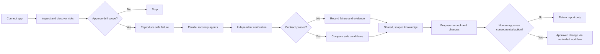

# RestoreLab

**Discover a recovery. Prove it works. Learn before the real disaster.**

> **Status:** In development for Daytona HackSprint NYC (October 2026). This README describes the product direction and intended hackathon MVP; it does not claim that the proposed features or integrations are already implemented.

RestoreLab is an autonomous disaster-recovery experimentation platform. It inspects an authorized application's code, configuration, dependencies, backups, and operational evidence; identifies recovery risks; proposes safe disaster scenarios; and runs **competing recovery investigations in isolated environments**. An independent verifier tests the restored *product*, not merely whether a process restarted or a backup command returned success. Findings become evidence-backed, reusable recovery knowledge, with human approval before consequential changes.

**The core question:** *When our application breaks, which recovery procedure can we prove will bring it back?*

## Why this matters

On January 31, 2017, GitLab.com experienced an accidental deletion of production database data. During recovery, engineers discovered that expected database backups were missing: a PostgreSQL tool-version mismatch caused the backup job to fail, and its failure notifications were rejected. GitLab restored from a staging copy after an approximately 18-hour outage, with some recent database changes permanently lost. Its [official postmortem](https://about.gitlab.com/blog/postmortem-of-database-outage-of-january-31/) describes the incident and the need to test recovery procedures regularly.

RestoreLab would **not** have prevented the accidental deletion. The opportunity is to discover that a supposed recovery path is unusable *before* it is urgently needed, experimentally investigate alternatives, and validate a working procedure against actual application requirements.

### Who it's for

- Small SaaS teams that have backups but seldom rehearse restoring the whole product.
- Platform and SRE teams that need tested, explainable recovery options and RTO/RPO evidence.
- Teams running AI-managed systems that need independent proof rather than an agent's claim that a fix worked.

## The product experience

1. **Connect and understand:** A developer connects a repository and deployment/configuration context. RestoreLab inspects authorized source, manifests, logs, backup metadata, dependencies, and, where permissioned, read-only infrastructure/telemetry. It derives a proposed application map and recovery contract. Developer-supplied acceptance criteria take precedence; inferred criteria require approval.
2. **Discover risks:** RestoreLab autonomously identifies plausible failure points, researches relevant documentation and prior incidents, and prioritizes candidate drills. The operator approves the experiment scope and permitted operations, not every investigation step.
3. **Break a safe copy:** Reproduce an authorized failure against synthetic or appropriately sanitized isolated infrastructure. Never fault-inject live production as part of the hackathon MVP.
4. **Investigate in parallel:** Independent recovery agents start from equivalent failure baselines and generate/test different plans using a bounded, allowlisted toolbox. They share factual discoveries and evidence, not unrestricted credentials or unverified fixes.
5. **Prove the outcome:** A separate verifier checks database integrity, API behavior, configuration, authentication, and an end-user browser journey against the recovery contract. An agent's self-report cannot mark its own attempt successful.
6. **Select and explain:** Reject any candidate that fails a hard requirement. Among verified-safe candidates, default to the fastest measured recovery; honor developer-defined RTO, RPO, cost, and other priorities. Show commands, evidence, residual risk, and rollback instructions.
7. **Learn and propose:** Store versioned recovery findings, failed hypotheses, applicability conditions, and verified procedures. Generate a human-reviewable runbook and suggested code/config changes; a GitHub PR is a stretch goal. Future trials must independently revalidate reused knowledge.

## What is different?

Resilience testing, backup verification, and AI-assisted remediation already exist, including [Gremlin Foresight AI](https://www.gremlin.com/release-notes/general), [AWS Resilience Hub](https://aws.amazon.com/resilience-hub/), and established backup-testing tools. RestoreLab is **not** claiming that fault injection, AI recommendations, or isolated restores are new individually.

Its proposed centerpiece is an **autonomous recovery-discovery tournament**: independently executed candidate strategies branch from an equivalent failure, collaborate through evidence-backed findings, and compete on externally verified application recovery. The output is not just a warning or a plausible recommendation, but a reproducible, reviewable recovery procedure with measured tradeoffs. Whether this combination delivers a meaningful advantage is what the MVP will test.

## Collaborative recovery intelligence (Mesh-inspired)

| Role | Responsibility |
| --- | --- |
| Scenario agent | Builds the application map, proposes failures, and prepares the approved recovery contract. |
| Recovery agents | Explore different hypotheses and execute bounded repair experiments in independent sandboxes. |
| Verification agent | Independently checks restored application and data against deterministic acceptance criteria. |
| Knowledge agent | Stores provenance, failed attempts, reusable discoveries, version compatibility, and supersession. |

Agents may share an observation like **“backup A fails because its dump-tool version is incompatible”** while continuing to test their own recovery strategies independently. Shared findings carry environment/version context, evidence, and permissions. No blanket credential sharing, automatic cross-tenant learning, or blindly executing another agent's recipe.

## Planned stack and sponsor roles

| Technology | Intended role |
| --- | --- |
| **Daytona** | Core isolation for autonomous agent execution and parallel recovery experiments. Container sandboxes can be recreated from a common snapshot; VM sandbox forks may be used where supported. Each candidate must start from an equivalent **full application and data** baseline, not merely the same source files. |
| **Arize AX** | Trace research and tool calls; evaluate investigation quality, failed hypotheses, verification consistency, and comparable repeat trials. Arize evaluates the loop; it does not replace deterministic application checks or persist the product's recovery knowledge. |
| **SurrealDB / Agent Memory** | Evidence/provenance graph joining application versions, incidents, hypotheses, attempts, outcomes, and verified runbooks. Reuse is scoped and revalidated. |
| **Anchor Browser** | Run an independent end-user journey—such as login and reading expected records—against each candidate's restored application. |
| **AWS** | Representative cloud infrastructure and/or hosting for the sample app; use isolated, controlled test resources. |
| **You.com (optional research adapter)** | Retrieve relevant vendor documentation and historical incidents, with source URLs and timestamps. External findings are hypotheses to test, never proof that a fix works. |
| **TypeScript, Node.js, Next.js, PostgreSQL** | Orchestration, dashboard, sample multi-service SaaS application, deterministic test fixtures, and recovery contracts. Python may support fault-scenario tooling. |

ElevenLabs is not a core dependency.

**Isolation note:** Daytona snapshots/forks do not automatically clone external databases or AWS resources. RestoreLab must seed each experiment's data and provision its external dependencies independently. See [Daytona sandbox documentation](https://www.daytona.io/docs/en/sandboxes/) for supported snapshot/fork semantics.

## Hackathon MVP: demonstrable, not simulated intelligence

The initial demonstration focuses on **database loss plus a broken/incompatible recovery path**, optionally coupled with a deployment/configuration failure. Other scenarios—service/dependency outages, misconfiguration/security hardening, and cloud resource loss—belong in the expansion roadmap.

**Required end-to-end proof:**

- One representative, owned multi-service app: frontend/login, API, PostgreSQL, seeded synthetic customer records, backup/restore artifacts, and a versioned recovery contract.
- Automatic intake/risk analysis and an operator-approved disaster drill.
- At least three independently executed recovery candidates starting from equivalent failure conditions.
- One plausible-looking attempt rejected because the product or data is still broken; one recovery that passes every hard gate.
- Independent SQL/data checks, API assertions, configuration checks, and an Anchor browser journey, with attached evidence.
- A dashboard showing the live tournament, agent findings, source-backed research where available, comparison, and proposed runbook.
- A human approval gate for any non-sandbox or consequential change.
- An optional comparable second trial showing whether previously verified knowledge improved success, recovery time, or investigation efficiency. If it does not improve, report that accurately.

**Out of scope for the MVP:** unrestricted pentesting, destructive production drills, arbitrary cloud-account control, universal onboarding, unsupervised production remediation, and unvalidated claims of outage-time reduction.

### Candidate selection policy

A recovery candidate is **ineligible**, regardless of speed, if it fails the approved contract: prohibited action, unacceptable data loss, missing evidence, integrity violation, failed API/auth/browser checks, or an incompatible environment. **Fastest verified-safe recovery wins by default**. Operators can specify stricter RTO/RPO, risk, or cost preferences. Measurements come from actual comparable trials, not an LLM's estimate.

### Safety and data handling

- Read-only discovery of connected real environments unless explicitly authorized otherwise.
- Destructive tests only inside owned, isolated environments using synthetic/sanitized data.
- Explicit approval of drill scope, permitted tools, and consequential changes; least-privilege scoped credentials.
- Allowlisted recovery commands/tools, sandbox budgets, timeouts, network/secret controls, and auditable tool traces.
- Source material and agent memory can inform plans but cannot override the approved recovery contract or security policy.
- No cross-customer transfer of private operational details or credentials. Unknown or unverified outcomes remain visibly unresolved.

## Three-minute demo narrative

| Time | What the judges see |
| --- | --- |
| 0:00–0:25 | A functioning SaaS app, the GitLab-inspired lesson, and the developer-approved recovery contract. |
| 0:25–0:55 | RestoreLab proactively discovers risk and injects a controlled database disaster; the expected backup path proves unusable. |
| 0:55–1:45 | Three Daytona-backed agents investigate alternatives. Their real traces and scoped factual discoveries appear live. |
| 1:45–2:25 | Independent verifier rejects superficially successful or data-losing attempts; accepts one genuinely functional recovery. |
| 2:25–3:00 | Display measured comparison, evidence, reusable runbook, human approval, and (if implemented) verified replay learning. |

A backup recording of the same genuine execution is prudent if live infrastructure has trouble during judging.

## How success is measured

- **Recovery correctness:** pass/fail of each approved contract gate, including an actual user journey.
- **Recovery time:** elapsed time to *verified* application recovery (not merely service startup).
- **Data loss:** observed versus accepted RPO, with integrity assertions.
- **Decision quality:** rejected false positives, unsafe suggestions, and unsupported claims.
- **Learning:** matched initial-versus-repeat experiments showing any measurable improvement, regression, or no change.
- **Reproducibility:** evidence linked to exact application version, failure fixture, candidate baseline, commands, and tool traces.

No improvement statistics or production readiness are claimed until actually measured.

## Four-developer workstreams

| Workstream | Deliverable |
| --- | --- |
| Infrastructure & fault lab | Representative app, seed/backup fixtures, Daytona environments, isolation, fault injection. |
| Autonomous discovery & agents | Intake/risk assessment, scenario selection, bounded recovery planner, research adapter, parallel agents. |
| Verification & knowledge | Recovery contracts, deterministic checks, Arize evaluations, SurrealDB evidence/reuse, candidate scoring. |
| Experience & integration | Next.js incident command center/tournament, Anchor user-journey tests, approval flow, end-to-end demo. |

## Roadmap

- **HackSprint:** one complete autonomous, safely approved recovery tournament with honest evidence.
- **Next:** additional failure scenarios; verified second-run learning; optional You.com research; automated suggested fixes and GitHub PRs.
- **Later:** repository/cloud connectors, scheduled continuous readiness checks, read-only production telemetry, deeper AWS isolation, controlled security hardening, and approved deployment of proven changes.

## Local development

Setup instructions, environment variable names, commands, repository structure, and screenshots will be added **after the first implementation is committed**. This avoids documenting commands or integrations that do not yet exist. Do not commit secrets, production credentials, customer data, or real backup contents.

## References

- [GitLab's official January 2017 incident postmortem](https://about.gitlab.com/blog/postmortem-of-database-outage-of-january-31/)
- [Gremlin release notes: Foresight AI](https://www.gremlin.com/release-notes/general)
- [Daytona sandbox documentation](https://www.daytona.io/docs/en/sandboxes/)
- [Arize AX tracing and evaluations](https://arize.com/docs/ax/observe)
- [SurrealDB Agent Memory documentation](https://surrealdb.com/docs/agent-memory)
- [You.com Web Search API documentation](https://you.com/docs/guides/search)

---

*RestoreLab is a proposed hackathon project, not affiliated with GitLab or the products referenced above. Historical incidents are included as motivation, not as claims that RestoreLab was deployed in those environments.*
